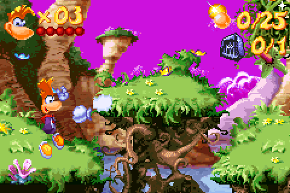
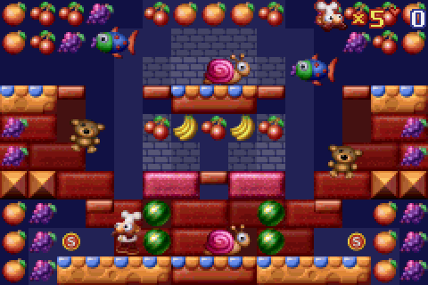
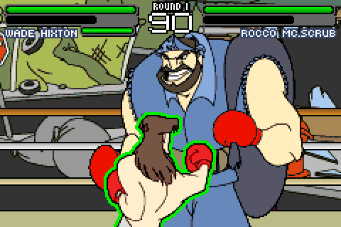
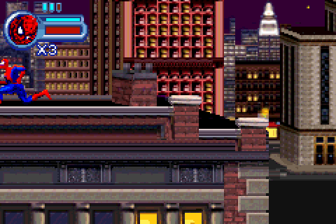
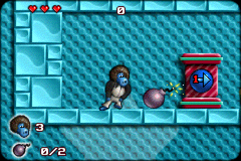
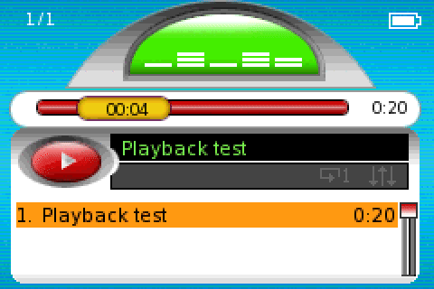
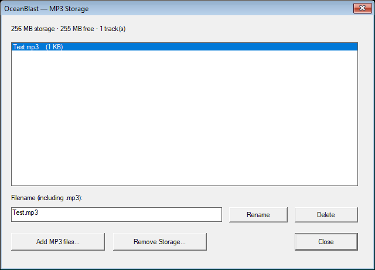

# OceanBlast

<p align="center"></p>

<p align="center">
  <a href="https://github.com/Vashiel/OceanBlast/releases"></a>
  <a href="LICENSE"></a>
  <a href="CHANGELOG.md"></a>
</p>

**OceanBlast** is an open-source, independent research and emulation project targeting the **Nikko digiBLAST** (2005), a European multimedia handheld console powered by the Samsung OCEAN-L-20 System-on-a-Chip (Samsung S3C2410 architecture, ARM920T CPU core).

The goal of this project is digital preservation, architectural documentation, and software interoperability for an obscure and historically undocumented platform.

---

## Emulated Gameplay Preview

| **Rayman 3** `[G] (M10)` | **Superstar Chefs** `[G] (EN)` |
| :---: | :---: |
|  |  |
| **Wade Hixton's Counter Punch** `[G] (EN)` | **Pitfall: The Lost Expedition** `[G] (EN)` |
|  |  |
| **Spider-Man: Mysterio's Menace** `[G] (EN)` | **Crazy Jack** `[G] (EN)` |
|  |  |

---

## MP3 Cartridge Preview

| **Original MP3 Player** | **Music Storage Manager** |
| :---: | :---: |
|  |  |

Load the MP3 firmware cartridge to create a separate **256-MB music store**. Import music from your computer, then use **Settings → MP3 Storage...** to add, rename or delete tracks, check free space, or remove the entire store. Storage lives in `sessions/mp3-storage.img` beside the executable; source music and the cartridge dump remain unchanged.

The animation shows a synthetic test tone in the original player. **MP3 support remains experimental:** some encodings fail, and audio fidelity and synchronization still need validation. See [MP3 storage, player workflow and technical limits](docs/51_mp3_storage_and_player.md).

---

## Quick Start & Windows Launcher

> **Prebuilt Windows Binaries:** Download an architecture-specific ZIP from [**v0.3.0-alpha**](https://github.com/Vashiel/OceanBlast/releases/tag/v0.3.0-alpha), extract it into its own folder, and run `oceanblast.exe`.

| Package | Intended platform | Validation |
| --- | --- | --- |
| [Windows 7–11 x64](https://github.com/Vashiel/OceanBlast/releases/download/v0.3.0-alpha/oceanblast-v0.3.0-alpha-windows7-11-x64.zip) | Windows 7 SP1 and newer, 64-bit | Windows 7 SP1 x64 regression checks and Windows 11 GUI smoke test |
| [Windows 7–11 x86](https://github.com/Vashiel/OceanBlast/releases/download/v0.3.0-alpha/oceanblast-v0.3.0-alpha-windows7-11-x86.zip) | Windows 7 SP1 and newer, 32-bit application; SSE2 required | Windows 7 x64 / WoW64 and Windows 11 GUI smoke test; 32-bit Windows OS unverified |

The original `win64.zip` remains available as the earlier Windows 11-tested build. Keep x86 and x64 installations in separate folders and preserve existing `sessions` storage when upgrading. Launcher EEPROM saves use `sessions/nvram/` and follow cartridge contents, including after a ROM rename. The previous shared `sessions/board.nvram` is retained during first-use migration; see [Chefs settings migration](docs/91_chefs_eeprom_health.md). Compatibility tests do not establish game speed or audio fidelity; see [Windows compatibility build results](docs/52_windows_7_and_x86_builds.md).

Double-click `bin/oceanblast.exe` (or `oceanblast.exe` from a release archive) without arguments to open the `1024×768` **OceanBlast** frontend:
1. Press **Ctrl+O**, choose **File → Load ROM…**, or **drag and drop** a legally dumped `.bin` cartridge image directly onto the OceanBlast start screen.
2. Open **Settings → Folders & System** to switch the interface language live between **English (Default)**, **Deutsch**, **Español**, **Italiano**, **Nederlands**, **Français**, and **Türkçe**.
3. Open **Settings → Controls** to test your controller live (XInput, DirectInput8, Google Stadia, Xbox, PlayStation, or generic USB gamepads), apply a controller preset (**Stadia / Xbox**, **PlayStation**, **digiBLAST / USB**), or click any row in the mapping table to interactively learn a controller button or keyboard key.
4. Adjust audio volume, aspect ratio (**3:2 Native**, **4:3**, **Stretched**), integer/smooth scaling, window appearance (**Plain Window**, interactive **Console Skin** via `--window-mode skin`, or **Fullscreen** via **F11** / **Alt+Enter**), and CPU timing under **Settings** (persisted to `%APPDATA%\OceanBlast\windows.ini`).

The MP3 firmware cartridge offers creation of a separate 256-MB music store on first launch. Use **Settings → MP3 Storage...** to add, rename or delete tracks while the emulator is stopped. Playback remains experimental; see [MP3 storage and player](docs/51_mp3_storage_and_player.md).

The **Playback** menu provides dedicated video controls and a cartridge language selection independent of the interface language; see [media input and language](docs/49_media_input_and_cartridge_language.md).

Automatic per-cartridge settings are enabled by default (see [docs/45](docs/45_cartridge_presets_gpio_keys_and_tlb_invalidation.md), [docs/43](docs/43_windows_launcher_and_controller_input.md), [docs/34](docs/34_automatic_cartridge_settings.md), and [docs/33](docs/33_console_skin_and_fullscreen.md)).

---

## Cartridge Compatibility Overview (2026-10-12)

All tested cartridges boot autonomously through the 4-KB S3C2410 Steppingstone SRAM, U-Boot 1.1.2 (`nidc` NAND ID & `checkbattery` ADC checks), and the embedded Linux 2.6.11 kernel without kernel panics or guest segmentation faults. Automatic per-cartridge CPU ratio presets (`2×`–`4×`) and the PGO unity build improve runtime pacing across the commercial game library; per-title frame rate and audio acceptance remain distinct compatibility measures.

For development results and the technical reports, see [**CHANGELOG.md**](CHANGELOG.md).

The [reviewed-build runtime validation](docs/50_runtime_acceptance.md) records actual gameplay scenes, paired build results, video capture limitations and unresolved graphics/audio issues.
The [host execution cost measurement](docs/53_host_execution_costs.md) separates guest CPU and bus work from GUI processing and pacing in reproducible Wade and Superstar Chefs runs.
The [host CPU sample profile](docs/54_host_cpu_samples.md) identifies the ARM execution, memory translation and peripheral functions active inside that cost.
The [frontend settings persistence notes](docs/55_frontend_settings_persistence.md) explain how control notifications and temporary controller fallbacks preserve saved preferences.

### 1. Commercial Game Cartridges (11 / 11 Boot to Game Binary)

| Cartridge Title | Boots (U-Boot + Linux) | Menus / In-Game Status | Audio Status | Display / Technical Notes & Docs |
| :--- | :---: | :---: | :---: | :--- |
| **Crazy Jack** `[G] (EN)` | Yes | Title, Level Select & In-Game | Plays (Auto 2×) | Native 12-bpp LCD444 via `GPH8 = 1`; Auto 2× preset ([docs/16](docs/16_i2c_eeprom_and_player_startup.md), [docs/25](docs/25_automatic_display_selection.md), [docs/42](docs/42_wade_gph8_lcd_mode.md), [docs/45](docs/45_cartridge_presets_gpio_keys_and_tlb_invalidation.md)) |
| **Cuccioli Cerca Amici** `[G] (IT)` | Yes | Main Menu & Save-Slot Select | Plays (Auto 3×) | 64 MB NAND (`0x98, 0x76`); Auto 3× preset ([docs/12](docs/12_game_cartridge_compatibility.md), [docs/28](docs/28_cartridge_register_audit.md), [docs/45](docs/45_cartridge_presets_gpio_keys_and_tlb_invalidation.md)) |
| **DigiQUAD** `[G] (EN)` | Yes | Main Menu & Racing Scene | Plays (Auto 2×) | Native 12-bpp LCD444 (`GPH8 = 1`); Auto 2× preset & `KEY_2` (`GPF5`) input ([docs/18](docs/18_manual_cartridge_validation.md), [docs/20](docs/20_pcm_capture_and_dma_sample_lifetime.md), [docs/42](docs/42_wade_gph8_lcd_mode.md), [docs/45](docs/45_cartridge_presets_gpio_keys_and_tlb_invalidation.md)) |
| **Gormiti: Agguato nella Valle** `[G] (IT)` | Yes | Title, Character Select & Bracket | Plays (Auto 3×) | 32 MB NAND; Auto 3× preset ([docs/17](docs/17_timer_and_runtime_validation.md), [docs/28](docs/28_cartridge_register_audit.md), [docs/45](docs/45_cartridge_presets_gpio_keys_and_tlb_invalidation.md)) |
| **Gormiti: Lotta Oscura** `[G] (IT)` | Yes | Intro & Title / Start Screen | Plays (Auto 3×) | 32 MB NAND; Auto 3× preset ([docs/12](docs/12_game_cartridge_compatibility.md), [docs/28](docs/28_cartridge_register_audit.md), [docs/45](docs/45_cartridge_presets_gpio_keys_and_tlb_invalidation.md)) |
| **Gormiti: Masters of the Gorm Island** `[G] (IT)` | Yes | Main Menu & In-Game Level/HUD | Plays (Auto 3×) | 16 MB NAND; Auto 3× preset ([docs/12](docs/12_game_cartridge_compatibility.md), [docs/28](docs/28_cartridge_register_audit.md), [docs/45](docs/45_cartridge_presets_gpio_keys_and_tlb_invalidation.md)) |
| **Pitfall: The Lost Expedition** `[G] (EN)` | Yes | Intro, Title & Gameplay | Smooth at Auto 3× | Native 12-bpp LCD444; Auto 3× preset & GBA `KEY_1/2/4/5/CTRL` input ([docs/21](docs/21_pitfall_original_hardware_reference.md), [docs/34](docs/34_automatic_cartridge_settings.md), [docs/45](docs/45_cartridge_presets_gpio_keys_and_tlb_invalidation.md)) |
| **Rayman 3** `[G] (M10)` | Yes | First level; about 40 host submissions/s | Auto 4×; no empty queues or dropped samples in measured gameplay | Magenta sky also appears in the supplied hardware capture; pacing is not hardware-speed validation ([docs/50](docs/50_runtime_acceptance.md)) |
| **Spider-Man: Mysterio's Menace** `[G] (EN)` | Yes | Main Menu, Story & In-Game | Plays (Auto 3×) | Auto 3× preset & full GBA `KEY_1/2/4/5/CTRL` input ([docs/12](docs/12_game_cartridge_compatibility.md), [docs/18](docs/18_manual_cartridge_validation.md), [docs/45](docs/45_cartridge_presets_gpio_keys_and_tlb_invalidation.md)) |
| **Superstar Chefs** `[G] (EN)` | Yes | First level; about 15 host submissions/s | Auto 3×; no empty queues or dropped samples in measured gameplay | Paired PGO builds retain identical final CPU, SDRAM and framebuffer state ([docs/50](docs/50_runtime_acceptance.md)) |
| **Wade Hixton's Counter Punch** `[G] (EN)` | Yes | First fight and knockdown | Auto 6×; paced first-fight interval sustains 120 MIPS with no new audio queue underflows or dropped samples | Startup still has audio underflows on the measured laptop. The first 1.85 music seconds loop one DMA buffer; the later match is not a preset change ([docs/52](docs/52_wade_ratio6_and_host_power.md), [docs/90](docs/90_wade_music_single_buffer.md)) |

### 2. Video & Combined Game+Video Cartridges

| Cartridge Group | Boots & Launches Player | Video Output | Media Controls & Audio | Notes & Documentation |
| :--- | :---: | :---: | :---: | :--- |
| **Gormiti / SpongeBob / Yu-Gi-Oh!** *(Video)* | Yes | Visible Episode Imagery | Keypad Controls Active | 240-row scanout & coherent frame latch ([docs/28](docs/28_cartridge_register_audit.md), [docs/31](docs/31_programmed_scanout_height.md), [docs/32](docs/32_coherent_video_and_vsync.md)) |
| **SpongeBob / Winx** *(IT/ES Combined Game+Video)* | Yes | Language Menu & Episode Video | Keypad Controls Active | Native 12-bpp LCD444 (`GPH8 = 1`) & I2C EEPROM ([docs/16](docs/16_i2c_eeprom_and_player_startup.md), [docs/42](docs/42_wade_gph8_lcd_mode.md)); intl. Winx has corrupt blocks ([docs/14](docs/14_rom_integrity.md)) |
| **Sonic X / Winx** *(IT/ES Video-Only)* | Yes | Complete source sweeps at Auto 3× | Dedicated controls tested; sync/fidelity remain unverified | About 12–13 submissions/s; known video-only dumps now enable native capture independently of CPU ratio ([docs/50](docs/50_runtime_acceptance.md)) |
| **Totally Spies / Winx** *(NL Video-Only)* | Yes | Black Framebuffer at Tested Budget | Player State Reaches `PLAYING` | Active framebuffer remains zeroed at 2.5B steps ([docs/28](docs/28_cartridge_register_audit.md), [docs/30](docs/30_realvideo_frame_delivery.md)) |

---

## Hardware & Emulated Subsystems

The Nikko digiBLAST hardware is built around the Samsung S3C2410A / OCEAN-L-20 processor:

| Subsystem | Hardware Specification | Emulation Status |
| :--- | :--- | :--- |
| **CPU Core, FPA11 & MMU** | ARM920T (ARMv4T, 32-bit ARM + 16-bit Thumb, CP15, MMU, 16 KB I/D-Cache) | Interpreter with fast page-cache, direct FPA11 (`cp1`/`cp2`) execution, $O(1)$ single-MVA TLB invalidation, AP faults (Linux COW), and bounded batches ([docs/05](docs/05_black_screen_investigation.md), [docs/37](docs/37_cpu_fetch_and_interpreter_execution.md), [docs/44](docs/44_superstar_chefs_analysis_and_fix.md), [docs/45](docs/45_cartridge_presets_gpio_keys_and_tlb_invalidation.md)) |
| **Memory & Boot** | 4 KB Steppingstone SRAM (`0x00000000`), 32 MB SDRAM (`0x30000000`) | Autonomous 4 KB NAND boot copy, SDRAM mirroring (`0x32000000`), and MMIO bus ([docs/01](docs/01_memory_map.md)) |
| **NAND Flash** | S3C2410 NAND (`0x4E000000`), Toshiba TC58 / Samsung K9 (16–128 MB) | Read ID (`0x90` for `nidc`), 512+16 raw OOB passthrough, and 1-bit Hamming ECC synthesis ([docs/03](docs/03_boot_progress.md), [docs/39](docs/39_photographed_cartridge_hardware.md)) |
| **Clocks & Timer 4** | PLL (`MPLLCON`, `CLKDIVN`) & PWM Timer 4 (`0x51000000`, `HZ=200`) | Register-derived FCLK/HCLK/PCLK, 200-Hz IRQ 14, and 1-µs `TCNTO4` interpolation ([docs/17](docs/17_timer_and_runtime_validation.md), [docs/23](docs/23_register_clocks_and_iis_pause.md), [docs/41](docs/41_wade_binary_and_s3c2410fb_analysis.md)) |
| **Display (`s3c2410fb`)** | 2.7" TFT LCD (`0x4D000000`, 240×160 / 240×240, 12-bpp LCD444 & 16-bpp RGB565) | DXGI VSync presenter, coherent frame latch, `GPH8` handheld LCD strap, 12-bpp & 16-bpp decoding ([docs/10](docs/10_color_depth_and_rgb565_support.md), [docs/32](docs/32_coherent_video_and_vsync.md), [docs/42](docs/42_wade_gph8_lcd_mode.md)) |
| **Audio (DMA2 + IIS)** | S3C2410 IIS (`0x55000000`), DMA Ch. 2 (`0x4B000080`), CS43L43 DAC | Consumed-sample DMA capture, dynamic IIS rate detection & Win32 `waveOut` resampler ([docs/20](docs/20_pcm_capture_and_dma_sample_lifetime.md), [docs/23](docs/23_register_clocks_and_iis_pause.md)) |
| **Input (`greykbd`)** | GPIO Ports F & G (`0x56000050`), External IRQs `EINT0..23` | D-Pad, A/B/C (`KEY_1/2/3/5`), L/R (`KEY_4/5` + `CTRL`), Start/Select, media keys (`KEY_P/S/B/N`), and XInput / DirectInput8 / Stadia controller remapping ([docs/33](docs/33_console_skin_and_fullscreen.md), [docs/43](docs/43_windows_launcher_and_controller_input.md), [docs/45](docs/45_cartridge_presets_gpio_keys_and_tlb_invalidation.md)) |
| **I2C EEPROM & ADC** | 2-KB I2C EEPROM (`0x54000000`), Battery ADC (`0x58000000`) | Persistent/volatile 2-KB EEPROM state and `checkbattery` ADC conversion ([docs/03](docs/03_boot_progress.md), [docs/16](docs/16_i2c_eeprom_and_player_startup.md)) |

---

## Development Roadmap

A [controlled before/after comparison](docs/80_controlled_total_comparison.md) runs two reversed-order Wade pairs with fresh normal builds, observed AC/Balanced power and identical processor affinity. Current source delivers about 32% more fight throughput and 23% less complete-replay CPU time on the measured host, with matching guest state. This combined result does not establish the same gain for other games, older hardware or the installed PGO build; earlier individual percentages must not be added.

The [active-scene check](docs/62_active_scene_acceptance.md) adds movement and A/B/C to a short first-level replay and records the limits of its performance evidence.

The [prioritized roadmap](ROADMAP.md) defines the path toward better performance on weaker CPUs: short baseline checks, an interchangeable CPU execution structure, shared timing boundaries, clearer memory semantics, and a measured block-execution/JIT prototype. It includes task budgets and early-stop rules: if the relevant problem is already visible on the title screen, stop the test there. These are planned milestones, not claims of completed performance improvements.

The [machine-core implementation report](docs/59_machine_core_and_decoder_experiment.md) records the extracted CPU state, scheduler, standalone MMU and shared machine owner, together with targeted checks and a rejected decoder-cache experiment. These foundations do not yet establish full-speed support on weak hardware.

[Legacy phase batches](docs/60_legacy_phase_batches.md) reduce interpreter bookkeeping and include a short developer-build comparison and local PGO title check. The goal is broad usability on old, low-end hardware. Portable core improvements proceed without requiring a particular device model; actual weak-device speed remains to be measured.

The subsequent [ARM dispatch measurement](docs/61_arm_dispatch_measurement.md) records a narrow immediate-operation shortcut and the short checks used to retain it.

## Building, Testing & Command-Line Usage

### Prerequisites
* A C++17 compiler (`g++` / MinGW-w64 or MSVC) and `windres` on Windows
* `make` (optional, for automated builds and test suites)

### Building from Source
```bash
make
```
This creates a developer executable at `build/oceanblast-dev.exe`; it leaves the installed launcher untouched. Build and install a Profile-Guided Optimization (PGO) unity binary for normal gameplay:
```powershell
& .\tools\build_profiled.ps1 -Roms @("path\to\cartridge.bin") -Steps 2100000000 -CpuStepsPerTick 3 -Optimization O3 -Unity -Install
```

### Running ROM-Free Regression Suites
```bash
make test
make test-windows
```

### Command-Line Invocation
```bash
bin/oceanblast.exe <path_to_cartridge_dump.bin> [--steps <N>] [--gui] [--window-mode <plain|skin>] [--fullscreen] [--scale <2|3|4>] [--sound] [--clock-mips <N>] [--profile]
```

### Default Controls (Configurable in **Settings → Controls**)
| Console Button | Hardware Line | Default Controller Binding | Host Keyboard Key |
| :--- | :--- | :--- | :--- |
| **D-Pad** | `GPF2` / `GPF7` / `GPF3` / `GPF6` | `D-Pad (POV Hat)` or `Left Stick` | `Arrow Keys` |
| **Button A / B / C** | `GPF0` (`KEY_1`) / `GPF5` (`KEY_2`) / `GPG12`+`GPF4` (`KEY_3`+`KEY_5`) | `B1 (A/Cross)` / `B2 (B/Circle)` / `B3 (X/Square)` (`B4` in Stadia/Xbox preset) | `Z` (`K`) / `X` (`J`) / `C` |
| **L / R Shoulder** | `GPG11`+`GPF1` / `GPG8`+`GPF4` | `B5 (LB/L1)` / `B6 (RB/R1)` | `A` (`Q`) / `S` (`W`) |
| **Game Start** | `GPG10`+`GPG8` (`EINT18`+`EINT16`) | `B8 (Start/Options)` (`B12` on Stadia DInput) | `Enter` |
| **Media Stop** | `GPG10` (`EINT18`) | Dedicated skin / Playback menu | `Backspace` or `F9` |
| **Game Select** | `GPG9`+`GPG11` (`EINT17`+`EINT19`) | `B7 (Back/Select)` (`B11` on Stadia DInput) | `Space` |
| **Media Play/Pause** | `GPG9` (`EINT17`) | Dedicated skin / Playback menu | `P` or `F10` |
| **Rewind / Forward** | `GPG0` / `GPG13` | `LT (L2)` / `RT (R2)` or `B9` / `B10` | `F8` / `F12` |
| **Open ROM / Fullscreen / Stop** | — | — | `Ctrl+O` / `F11` (`Alt+Enter`) / `Escape` |

---

## Legal & Interoperability Notice

### 1. Independent Reverse-Engineering & Interoperability Implementation
OceanBlast is an independent open-source software implementation written from scratch for hardware documentation, digital preservation, and interoperability. Hardware and system behavior is modeled using publicly available documentation (such as the *Samsung S3C2410A User's Manual*) combined with empirical protocol and binary interoperability analysis.

### 2. No Proprietary Assets, Firmware, or ROMs
* OceanBlast **does not contain, distribute, host, or link to** any proprietary software, bootloader/kernel binaries, copyrighted game ROMs, commercial operating system images, or cryptographic secrets.
* All testing and usage of this emulator require users to supply their own legally acquired cartridge dumps for personal preservation and research purposes.
* Reconstructed visual skin assets in `assets/` are original vector/raster reconstructions created for the emulator interface.

### 3. Research, Preservation & Interoperability Context
Development and interoperability analysis are conducted in good faith for research, education, digital preservation, and software compatibility (see, where applicable in your jurisdiction, statutory provisions regarding interoperability and research such as EU Directive 2009/24/EC Art. 6, 17 U.S.C. § 1201(f), or § 69e UrhG). *Note: This statement describes the project's technical scope and intent and does not constitute legal advice.*

### 4. Trademark & Nominative Use Notice
All product names, logos, brands, and trademarks—including **Nikko**, **digiBLAST**, **Grey Innovation**, **Samsung**, **RealPlayer**, **Ubisoft**, and individual game or media titles—are the property of their respective owners and are referenced solely for descriptive identification. OceanBlast is completely independent and is not affiliated with, authorized, sponsored, or endorsed by Nikko Entertainment B.V., Grey Innovation Pty Ltd, Samsung Electronics Co., Ltd., or any game publishers.

### 5. Disclaimer of Warranty
THIS SOFTWARE IS PROVIDED "AS IS", WITHOUT WARRANTY OF ANY KIND, EXPRESS OR IMPLIED. SEE THE [GNU GENERAL PUBLIC LICENSE v3.0](LICENSE) FOR FULL TERMS.

---

## License
This project is licensed under the **GNU General Public License v3.0** (GPLv3). See the [LICENSE](LICENSE) file for the full license text.
