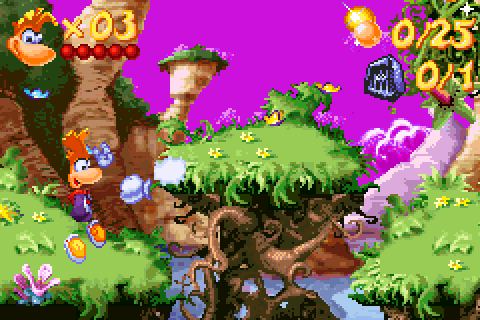
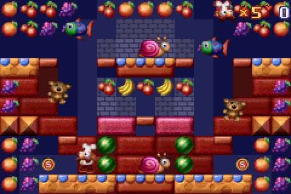
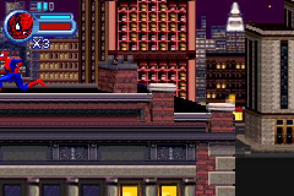
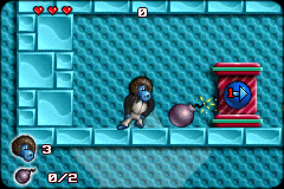
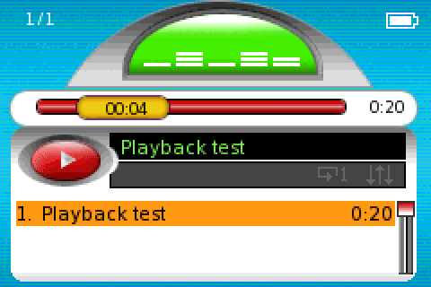
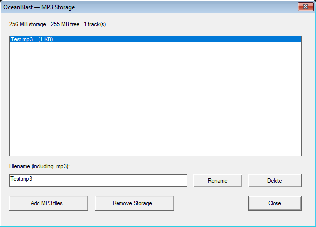

# OceanBlast

<p align="center"></p>

<p align="center">
  <a href="https://github.com/Vashiel/OceanBlast/releases"></a>
  <a href="LICENSE"></a>
  <a href="docs/README.md"></a>
  <a href="CHANGELOG.md"></a>
</p>

**OceanBlast** is an open-source research and emulation project targeting the **Nikko digiBLAST** (2005), a European multimedia handheld console powered by the Samsung OCEAN-L-20 System-on-a-Chip (Samsung S3C2410A architecture, ARM920T CPU core running U-Boot 1.1.2 and embedded Linux 2.6.11).

---

## I Need YOUR Help!

OceanBlast was built from very little public documentation — mostly from cartridge dumps, scattered notes shared by a handful of people online, and even **photos of opened cartridges on Reddit** used to identify the chips on the board. I own neither a real digiBLAST console nor any cartridges to test against — a huge thank you to all the dumpers out there who made this project possible!

**`v0.4.1`** adds a Windows audio worker and built-in diagnostic export. The speed indicator reports modeled time relative to elapsed time. Game frame rates vary by scene. In the released build, the displayed LCD value scales with modeled speed.

A follow-up replay of *Wade Hixton's Counter Punch* reproduced audio interruptions during startup. The development build reduces fast recovery bursts after a slowdown and lowers the cost of the guest kernel's idle loop. Remaining audio interruptions are tracked in the [timing and audio measurements](docs/118_runtime_pacing_and_audio_delivery.md).

### How You Can Help (Starting with `v0.4.1`)
1. Open **Settings → Timing & Diagnostics** and make sure **Log FPS & audio metrics (`performance.csv`)** is **enabled** *(leave **Extended debug logging** **off** for normal speed)*.
2. Play a game briefly (ideally testing both with sound **on** and **off** if you experience slowdowns).
3. Export your log using **File → Export Diagnostic Log (`.zip` / `.txt`)** or **File → Upload Log to `paste.rs`** (your Windows user path is stripped automatically, and the `paste.rs` link is copied to your clipboard).
4. Open a new **[GitHub Issue](https://github.com/Vashiel/OceanBlast/issues/new)** and either **attach / paste the exported `.zip` or `.txt` file** manually, or simply **paste the `paste.rs` link** into the issue.

Every log from a different PC, CPU, or audio setup helps move OceanBlast forward!

---

## Highlights & Current Status

* **Full Autonomous Boot & Commercial Game Library (11 / 11 Titles):** Autonomously boots the 4-KB S3C2410 Steppingstone SRAM, U-Boot 1.1.2 (`nidc` NAND ID & `checkbattery` ADC checks), and embedded Linux 2.6.11 (`squashfs`, `devfs`, `s3c2410fb`, `cs43l43` ALSA sound, `greykbd` GPIO keypad) across all 11 tested commercial game cartridges.
* **Cross-Platform x86-64 JIT & Portable ARM64 Interpreter:** Features a single-pass x86-64 native JIT backend (`X64ExecutionEngine`) supporting both Windows x64 and Linux System-V AMD64 ABIs (`R12`/`R13` entry bridge, 4,096-bucket intrusive code cache, 2-way guarded window linking, inline TLB fast path, and per-4 KB TLB mapping generations reaching ~90% native coverage in active scenes), paired with an exact ARM920T reference interpreter, direct **ARM FPA11 (`cp1`/`cp2`)** hardware float execution, and ARM64 Linux (`aarch64`) support.
* **Win32 Launcher & Portable SDL2 Frontend:** On Windows 7–11, includes a resizable `1024×768` Win32/DXGI VSync launcher with live 7-language UI localization (**English**, **Deutsch**, **Español**, **Italiano**, **Nederlands**, **Français**, **Türkçe**), interactive **Console Skin**, fullscreen (`F11`), per-cartridge NVRAM saves (`sessions/nvram/`), and live **XInput / DirectInput8 / Stadia / PlayStation / USB** controller remapping. On Linux (`x86_64` and `aarch64`), provides an SDL2 video/audio/GameController player (`display_sdl.cpp`, `audio_sdl.cpp`).
* **MP3 Player Cartridge & 256-MB Music Store Manager:** Opt-in S3C2410 OHCI USB mass-storage emulation (`sessions/mp3-storage.img`) with an integrated FAT16 track manager (**Settings → MP3 Storage...**).

---

## Emulated Gameplay Preview

| **Rayman 3** `[G] (M10)` | **Superstar Chefs** `[G] (EN)` |
| :---: | :---: |
|  |  |
| **Wade Hixton's Counter Punch** `[G] (EN)` | **Pitfall: The Lost Expedition** `[G] (EN)` |
|  |  |
| **Spider-Man: Mysterio's Menace** `[G] (EN)` | **Crazy Jack** `[G] (EN)` |
|  |  |

---

## MP3 Cartridge Preview

| **Original MP3 Player** | **Music Storage Manager** |
| :---: | :---: |
|  |  |

Load the MP3 firmware cartridge to create a separate **256-MB FAT16 music store** (`sessions/mp3-storage.img`), then use **Settings → MP3 Storage...** to import, rename, or delete `.mp3` tracks. See [MP3 Storage & Player Documentation](docs/51_mp3_storage_and_player.md).

---

## Quick Start & Platforms

| Package | Target Platform | Execution Engine & Graphics |
| :--- | :--- | :--- |
| **`oceanblast-v0.4.0-windows7-11-x64.zip`** (`bin/oceanblast.exe`) | Windows 7 SP1 – Windows 11 (64-bit) | **x86-64 Native JIT + Interpreter Hybrid**, dynamic D3D11/DXGI VSync with automatic GDI fallback |
| **`oceanblast-v0.4.0-windows7-11-x86.zip`** (`bin/oceanblast-x86.exe`) | Windows 7 SP1 – Windows 11 (32-bit x86, SSE2) | **Profile-Guided (PGO) ARM920T Interpreter**, dynamic D3D11/DXGI VSync with automatic GDI fallback |
| **`oceanblast-v0.4.0-linux-x64.tar.gz`** (`oceanblast`) | Linux x86-64 (GLIBC 2.35+, SDL2) | **x86-64 Native JIT (System-V ABI) + Interpreter Hybrid**, SDL2 video/audio/gamepad |
| **`oceanblast-v0.4.0-linux-arm64.tar.gz`** (`oceanblast`) | Linux ARM64 (`aarch64`, GLIBC 2.35+, SDL2) | **ARM920T + FPA11 Interpreter**, SDL2 video/audio/gamepad |

Double-click `bin/oceanblast.exe` on Windows (or download an archive from [GitHub Releases](https://github.com/Vashiel/OceanBlast/releases)) to start:

1. **Windows GUI Launcher:** Extract all archive files (including `assets/digiblast-skin.png` for Console Skin mode) and launch `oceanblast.exe` with no arguments, then press **Ctrl+O**, choose **File → Load ROM…**, or **drag and drop** a legally dumped `.bin` / `.rom` image onto the window.
2. **Linux x86-64 & ARM64 (`libsdl2-2.0-0`):** Install the SDL2 runtime (`sudo apt install libsdl2-2.0-0` on Debian/Ubuntu) and launch `./oceanblast <cartridge.bin> --gui --sound [--scale 3]`.
3. **Language & System:** On Windows, open **Settings → Folders & System** to switch the UI language live or configure your default ROM directory. Use the **Playback** menu (or `--cart-language <lang>` on CLI) to select cartridge language.
4. **Controls:** Open **Settings → Controls** on Windows to customize presets (**Stadia / Xbox**, **PlayStation**, **digiBLAST / USB**) or rebind keys/pads; Linux builds support keyboard mappings and standard SDL2 `GameController` pads out of the box.
5. **Video & Audio:** Adjust audio volume, aspect ratio (**3:2 Native**, **4:3**, **Stretched**), scaling, and **Fullscreen** via **F11** / **Alt+Enter**.

### Default Controls (Configurable in **Settings → Controls**)

| Console Button | S3C2410 GPIO Line | Default Controller Binding | Host Keyboard Key |
| :--- | :--- | :--- | :--- |
| **D-Pad** | `GPF2` / `GPF7` / `GPF3` / `GPF6` | `D-Pad (POV Hat)` or `Left Stick` | `Arrow Keys` |
| **Button A / B / C** | `GPF0` (`KEY_1`) / `GPF5` (`KEY_2`) / `GPG12`+`GPF4` (`KEY_3`+`KEY_5`) | `A/Cross` / `B/Circle` / `X/Square` | `Z` (`K`) / `X` (`J`) / `C` |
| **L / R Shoulder** | `GPG11`+`GPF1` / `GPG8`+`GPF4` | `LB (L1)` / `RB (R1)` | `A` (`Q`) / `S` (`W`) |
| **Game Start / Select** | `GPG10`+`GPG8` / `GPG9`+`GPG11` | `Start (Options)` / `Back (Select)` | `Enter` / `Space` |
| **Media Play / Stop** | `GPG9` (`EINT17`) / `GPG10` (`EINT18`) | Dedicated skin / Playback menu | `P` (`F10`) / `Backspace` (`F9`) |
| **Rewind / Forward** | `GPG0` / `GPG13` | `LT (L2)` / `RT (R2)` | `F8` / `F12` |
| **Open ROM / Fullscreen / Stop** | — | — | `Ctrl+O` / `F11` (`Alt+Enter`) / `Escape` |

---

## Cartridge Compatibility

All 11 tested commercial game cartridges boot autonomously through Steppingstone SRAM, U-Boot, and Linux 2.6.11 into interactive gameplay with automatic per-cartridge presets (`src/core/cartridge_settings.h`):

### 1. Commercial Game Cartridges (11 / 11 Boot & Playable)

| Cartridge Title | Boots (U-Boot + Linux) | Menus & In-Game Status | Audio Status | Display & Technical Notes |
| :--- | :---: | :---: | :---: | :--- |
| **Crazy Jack** `[G] (EN)` | Yes | Title, Level Select & In-Game | Plays (Auto 2×) | Native 12-bpp LCD444 (`GPH8 = 1`) |
| **Cuccioli Cerca Amici** `[G] (IT)` | Yes | Main Menu & In-Game | Plays (Auto 3×) | 64 MB NAND (`0x98, 0x76`); 12-bpp LCD444 |
| **DigiQUAD** `[G] (EN)` | Yes | Main Menu & Racing Scene | Plays (Auto 2×) | Native 12-bpp LCD444 (`GPH8 = 1`) |
| **Gormiti: Agguato nella Valle** `[G] (IT)` | Yes | Title, Character Select & Bracket | Plays (Auto 3×) | 32 MB NAND (`0x98, 0x75`); 16-bpp RGB565 |
| **Gormiti: Lotta Oscura** `[G] (IT)` | Yes | Intro, Title & Gameplay | Plays (Auto 3×) | 32 MB NAND (`0x98, 0x75`); 16-bpp RGB565 |
| **Gormiti: Masters of the Gorm Island** `[G] (IT)` | Yes | Main Menu & In-Game Level/HUD | Plays (Auto 3×) | 16 MB NAND (`0x98, 0x73`); 16-bpp RGB565 |
| **Pitfall: The Lost Expedition** `[G] (EN)` | Yes | Intro, Title & Gameplay | Smooth (Auto 3×) | Native 12-bpp LCD444 |
| **Rayman 3** `[G] (M10)` | Yes | Intro, Title & In-Game Levels | Smooth (Auto 4×) | 16-bpp RGB565; ~40 frame submissions/s |
| **Spider-Man: Mysterio's Menace** `[G] (EN)` | Yes | Main Menu, Story & In-Game | Plays (Auto 3×) | 16-bpp RGB565 |
| **Superstar Chefs** `[G] (EN)` | Yes | Menus & In-Game Levels | Smooth (Auto 3×) | Native 12-bpp LCD444; FPA11 audio synthesis & EEPROM health migration |
| **Wade Hixton's Counter Punch** `[G] (EN)` | Yes | Intro, Title & Boxing Matches | Plays (Auto 6×) | Native 12-bpp LCD444 (`GPH8 = 1`); ~90% native x86-64 JIT execution |

### 2. Video & Combined Game+Video Cartridges

| Cartridge Group | Boots & Launches Player | Video Output | Media Controls & Audio | Technical Notes |
| :--- | :---: | :---: | :---: | :--- |
| **Gormiti / SpongeBob / Yu-Gi-Oh!** *(Video)* | Yes | Visible Episode Video | Keypad Controls Active | 240-row scanout & coherent frame latch |
| **SpongeBob / Winx** *(IT/ES Combined)* | Yes | Language Menu & Episode Video | Keypad Controls Active | 12-bpp LCD444 (`GPH8 = 1`) & I2C EEPROM |
| **Sonic X / Winx** *(IT/ES Video-Only)* | Yes | Complete Frame Sweeps (Auto 3×) | Keypad Controls Active | Native frame capture enabled automatically |
| **Totally Spies / Winx** *(NL Video-Only)* | Yes | Black Framebuffer | Player State `PLAYING` | Active framebuffer remains zeroed (see [docs/30](docs/30_realvideo_frame_delivery.md)) |

---

## Hardware & Emulated Subsystems

| Subsystem | S3C2410A / OCEAN-L-20 Specification | OceanBlast Implementation |
| :--- | :--- | :--- |
| **x86-64 JIT Backend** | ARM920T (ARMv4T 32-bit ARM + 16-bit Thumb) | Shared ARM/Thumb IR, single-pass `x86::Assembler`, shared Windows x64 entry bridge (`R12`/`R13`), 4,096-bucket intrusive cache, 2-way guarded window links, inline TLB reads, per-4 KB TLB mapping generations ([docs/115](docs/115_shared_native_entry_and_dispatch.md), [docs/116](docs/116_page_tlb_generation_and_flat_mmio.md)) |
| **Interpreter, FPA11 & MMU** | ARM920T CP15, 16 KB I/D-Cache, MMU | Reference/fallback interpreter, direct FPA11 (`cp1`/`cp2`) hardware float execution, compact 8-byte 2,048-entry TLB, $O(1)$ MVA invalidation, and Linux COW permission faults ([docs/44](docs/44_superstar_chefs_analysis_and_fix.md), [docs/82](docs/82_compact_tlb_entries.md)) |
| **Memory & Flat MMIO Bus** | 4 KB Steppingstone SRAM (`0x00000000`), 32 MB SDRAM (`0x30000000`) | Autonomous 4 KB NAND boot copy, SDRAM mirror (`0x32000000`), and `constexpr`-indexed flat `O(1)` S3C2410 MMIO register table ([docs/01](docs/01_memory_map.md), [docs/116](docs/116_page_tlb_generation_and_flat_mmio.md)) |
| **NAND Flash & USB OHCI** | S3C2410 NAND (`0x4E000000`), USB Host (`0x49000000`) | Read ID (`0x90`), 512+16 raw OOB passthrough, 1-bit Hamming ECC synthesis, and opt-in OHCI USB 1.1 mass storage ([docs/39](docs/39_photographed_cartridge_hardware.md), [docs/51](docs/51_mp3_storage_and_player.md)) |
| **Clocks & Timer 4** | PLL (`MPLLCON`, `CLKDIVN`) & PWM Timer 4 (`0x51000000`, `HZ=200`) | Shared 20-MHz peripheral clock unit, register-derived FCLK/HCLK/PCLK, 200-Hz IRQ 14, and 1-µs `TCNTO4` interpolation ([docs/110](docs/110_common_timing_model_and_calibration.md)) |
| **Display (`s3c2410fb`)** | 2.7" TFT LCD (`0x4D000000`, 240×160 / 240×240) | DXGI VSync presenter, coherent frame latch, `GPH8 = 1` handheld 12-bpp LCD444 strap, and 16-bpp RGB565 decoding ([docs/32](docs/32_coherent_video_and_vsync.md), [docs/42](docs/42_wade_gph8_lcd_mode.md)) |
| **Audio (DMA2 + IIS)** | S3C2410 IIS (`0x55000000`), DMA Ch. 2 (`0x4B000080`), CS43L43 DAC | Consumed-sample DMA2 capture, dynamic IIS sample-rate detection, and Win32 `waveOut` resampler ([docs/20](docs/20_pcm_capture_and_dma_sample_lifetime.md)) |
| **I2C EEPROM & ADC** | 2-KB I2C EEPROM (`0x54000000`), Battery ADC (`0x58000000`) | Per-cartridge persistent 2-KB EEPROM (`sessions/nvram/`) and `checkbattery` ADC conversion ([docs/16](docs/16_i2c_eeprom_and_player_startup.md), [docs/91](docs/91_chefs_eeprom_health.md)) |

---

## Building & Testing from Source

### 1. x86-64 JIT Build (Windows 7–11 & Linux)

Requires a C++20 compiler (`g++` with MinGW-w64 on Windows, or GCC/Clang + `libsdl2-dev` on Linux), CMake 3.24+, and Ninja:

```bash
cmake -S jit -B build/jit -G Ninja -DCMAKE_BUILD_TYPE=Release
cmake --build build/jit -j 8
ctest --test-dir build/jit --output-on-failure
```

This builds `build/jit/oceanblast_jit_player` (`.exe` on Windows, SDL2 backend on Linux; rename/copy to `bin/oceanblast`) and runs all 13 ROM-free CTest verification suites (`x64_clocked_timing`, `x64_execution`, `x64_entry_abi`, `native_semantics`, `x64_memory`, `x64_invalidation`, `jit_cpu_regression`, `jit_emulation_timing`, `timing_contract`, `timing_audio_clock`, `timing_timer4`, `timing_dma_audio_stream`, `timing_landmarks`). On GNU/Linux, `-DOCEANBLAST_STATIC_STDLIB=ON` (default) statically links `libstdc++` and `libgcc` while using system `libSDL2-2.0.so.0` (`libsdl2-2.0-0`).

### 2. Portable / ARM64 Linux Build (Interpreter + SDL2)

For ARM64 Linux (`aarch64`, e.g. Raspberry Pi / ARM SBCs) or non-JIT hosts, use the top-level CMake project (CMake 3.20+):

```bash
cmake -S . -B build/linux-arm64 -G Ninja -DCMAKE_BUILD_TYPE=Release -DCMAKE_TOOLCHAIN_FILE=cmake/aarch64-linux-gnu.cmake
cmake --build build/linux-arm64 -j 8
ctest --test-dir build/linux-arm64 --output-on-failure
```

This builds `build/linux-arm64/oceanblast` with the ARM920T + FPA11 interpreter and SDL2 video/audio/controller backends and runs all 19 portable CTest suites (using `qemu-aarch64-static` automatically when cross-compiling if installed).

### 3. Legacy `Makefile` Build (Windows Interpreter / Tools)

```bash
make
make test
```

### 4. Command-Line Invocation

```bash
bin/oceanblast <cartridge.bin> [--gui] [--sound] [--engine <jit|interpreter>] [--scale <2|3|4>] [--window-mode <plain|skin>] [--fullscreen]
```

---

## Documentation & Research Archive

* **[Technical Documentation Index (`docs/README.md`)](docs/README.md):** Structured subsystem reference and indexed archive of all hardware reverse-engineering and validation reports (`docs/00`–`docs/118`).
* **[Development Roadmap (`ROADMAP.md`)](ROADMAP.md):** Current J0–J6 and T0–T4 milestone status and validation rules.
* **[Changelog (`CHANGELOG.md`)](CHANGELOG.md):** Release and milestone history.

---

## Legal & Interoperability Notice

1. **Independent Reverse-Engineering & Interoperability Implementation:** OceanBlast is an independent open-source software implementation written from scratch for hardware documentation, digital preservation, and interoperability using publicly available documentation (such as the *Samsung S3C2410A User's Manual*) combined with empirical protocol and binary interoperability analysis.
2. **No Proprietary Assets, Firmware, or ROMs:** OceanBlast **does not contain, distribute, host, or link to** any proprietary software, bootloader/kernel binaries, copyrighted game ROMs, commercial operating system images, or cryptographic secrets. All usage requires legally acquired cartridge dumps supplied by the user.
3. **Trademark Notice:** All product names, logos, brands, and trademarks—including **Nikko**, **digiBLAST**, **Grey Innovation**, **Samsung**, **RealPlayer**, **Ubisoft**, and individual game or media titles—are the property of their respective owners and are referenced solely for descriptive identification. OceanBlast is not affiliated with, authorized, sponsored, or endorsed by Nikko Entertainment B.V., Grey Innovation Pty Ltd, Samsung Electronics Co., Ltd., or any game publishers.
4. **Disclaimer of Warranty:** THIS SOFTWARE IS PROVIDED "AS IS", WITHOUT WARRANTY OF ANY KIND, EXPRESS OR IMPLIED. SEE THE [GNU GENERAL PUBLIC LICENSE v3.0](LICENSE) FOR FULL TERMS.

---

## License

This project is licensed under the **GNU General Public License v3.0** (GPLv3). See the [LICENSE](LICENSE) file for the full license text.
